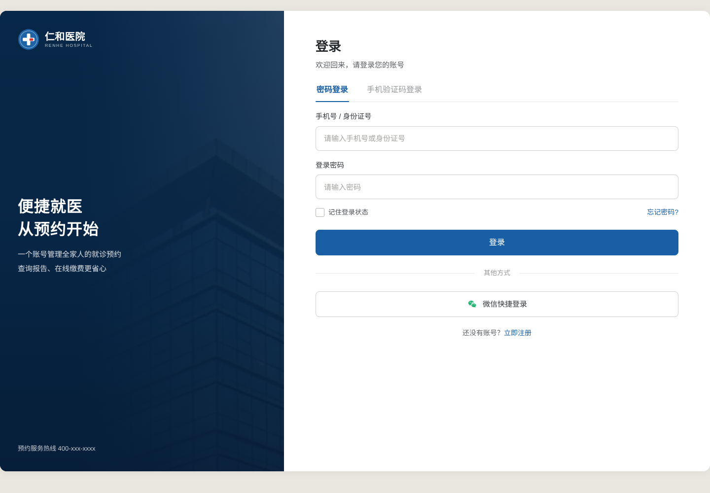
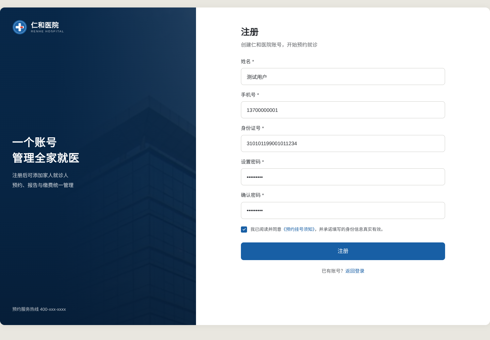
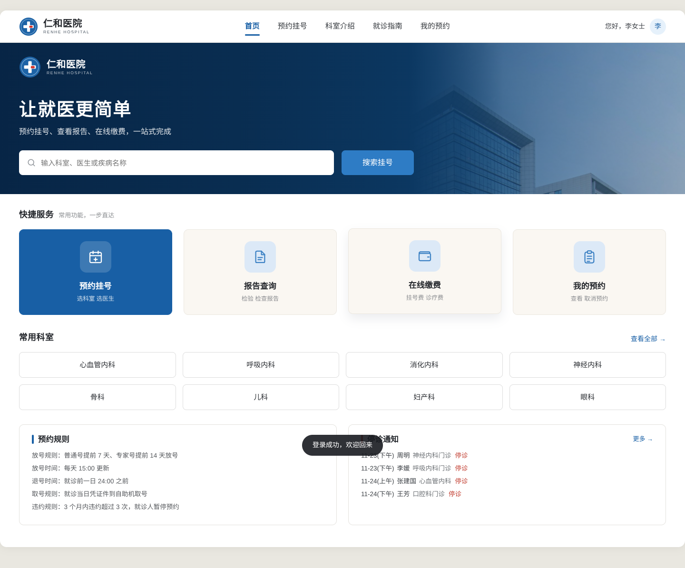

# 仁和医院预约挂号系统

软件工程导论综合性大实验项目，桌面端 Web 预约挂号系统。前端页面按设计稿还原，后端使用 Spring Boot + MySQL，登录与注册已接入数据库，其余业务页面使用前端模拟数据演示。



## 技术栈

- 前端：原生 HTML / CSS / JavaScript，单页应用，无构建步骤
- 后端：Java 17、Spring Boot 3.3.5、Spring Web、Spring Data JPA、Bean Validation
- 数据库：MySQL 8.0 及以上（兼容 9.x），JDBC + HikariCP，Connector/J 9.6
- 安全：BCrypt 密码哈希、HttpSession 会话、服务端参数校验
- 构建：Maven（附 Maven Wrapper）

## 功能范围

已完成并可在浏览器中走通的流程：

- 登录、注册（数据库）
- 首页、科室介绍、就诊指南
- 预约挂号：选科室 → 选医生 → 选时间 → 确认预约 → 预约成功
- 我的预约：待就诊、已完成、已取消、已违约
- 新增就诊人、报告查询、在线缴费
- 预约黑名单：3 个月内违约超过 3 次暂停预约，满 3 个月无新增违约自动解除

本次课程要求中，登录与注册为真实数据库读写；医生、排班、预约、报告、缴费等页面仍使用浏览器内存中的模拟数据，刷新后恢复初始状态。数据库脚本中已设计对应的 8 张业务表，便于后续继续接入。

## 目录结构

```
renhe-hospital
├─ database
│  └─ renhe_hospital.sql          完整建库脚本（含演示数据）
├─ docs
│  └─ screenshots                 运行截图
├─ src/main/java/com/renhe/hospital
│  ├─ auth                        注册、登录、会话接口
│  ├─ common                      统一响应、异常处理
│  ├─ config                      密码编码器
│  └─ user                        用户、就诊人实体与仓储
├─ src/main/resources
│  ├─ application.yml             数据库与端口配置
│  ├─ db
│  │  ├─ schema.sql               表结构
│  │  └─ data.sql                 演示数据
│  └─ static/index.html           前端页面（单文件）
├─ src/test                       注册登录接口测试
├─ start.bat                      Windows 一键启动
├─ start.sh                       macOS / Linux 启动
└─ pom.xml
```

## 数据库设计

数据库名 `renhe_hospital`，共 8 张业务表：

| 表名 | 说明 | 关键字段 |
| --- | --- | --- |
| sys_user | 登录账号 | phone、id_card、password_hash、role、status |
| patient | 就诊人 | user_id、name、relation、id_type、id_no |
| department | 科室 | code、name、intro、location |
| doctor | 医生 | department_id、name、title、good_at、fee |
| schedule | 排班 | doctor_id、work_date、period、remaining_slots |
| appointment | 预约记录 | appointment_no、user_id、patient_id、status |
| medical_report | 检查检验报告 | patient_id、category、title、conclusion |
| payment | 缴费记录 | payment_no、user_id、amount、status |

主要关系：一个账号可添加多个就诊人；科室包含多名医生；医生按日期和上午/下午排班；预约关联账号、就诊人、医生与排班；报告与缴费关联就诊人和预约。

注册成功时会同时写入 `sys_user` 和一条“本人”就诊人记录 `patient`。密码只保存 BCrypt 哈希，不保存明文。

## 快速开始

### 环境要求

- JDK 17 或更高版本
- MySQL 8.0 或更高版本（9.x 也可），已启动并监听 3306 端口
- 首次启动需要联网下载 Maven 依赖

### 方式一：一键启动（Windows）

1. 确认 MySQL 已启动。
2. 双击 `start.bat`。
3. 按提示输入 MySQL 密码，直接回车使用默认密码 `123456`。
4. 脚本会启动服务并自动打开 `http://localhost:8080`。

首次启动会自动创建数据库、8 张表和演示数据，需要 MySQL 账号具备建库建表权限。若数据库账号权限受限，可先手动导入脚本：

```bash
mysql -u root -p < database/renhe_hospital.sql
```

### 方式二：命令行启动

```bash
cd renhe-hospital
./mvnw spring-boot:run
```

Windows：

```bat
mvnw.cmd -s settings.xml spring-boot:run
```

已安装 Maven 时也可以使用 `mvn -s settings.xml spring-boot:run`。项目自带 `settings.xml` 使用阿里云镜像，首次下载依赖更快。修改数据库密码：

```bash
set DB_PASSWORD=你的密码
```

或在 `src/main/resources/application.yml` 中修改默认值。也可通过环境变量 `DB_USERNAME`、`DB_URL`、`SERVER_PORT` 覆盖配置。

### 默认演示账号

- 手机号：`13800138000`
- 密码：`Renhe@123`
- 也可使用身份证号 `310101199001011234` 登录

首次使用建议从注册页创建自己的账号，注册成功会回到登录页并自动填入手机号。



## 登录注册接口

统一响应格式：

```json
{ "code": 0, "message": "ok", "data": {} }
```

| 方法 | 路径 | 说明 |
| --- | --- | --- |
| POST | /api/auth/register | 注册，写入账号与默认就诊人 |
| POST | /api/auth/login | 登录，成功后写入 Session |
| GET | /api/auth/me | 获取当前登录用户 |
| POST | /api/auth/logout | 退出登录，销毁 Session |

注册请求示例：

```json
{
  "name": "张三",
  "phone": "13800138000",
  "idCard": "310101199001011234",
  "password": "Renhe@123",
  "confirmPassword": "Renhe@123"
}
```

登录请求示例：

```json
{
  "account": "13800138000",
  "password": "Renhe@123",
  "remember": false
}
```

`account` 支持手机号或身份证号。勾选“记住登录状态”时会话有效期 7 天，否则 30 分钟。

主要错误码：

| 错误码 | 含义 |
| --- | --- |
| 40001 | 参数校验失败或两次密码不一致 |
| 40100 | 未登录或会话失效 |
| 40101 | 账号或密码错误 |
| 40301 | 账号已停用 |
| 40901 | 手机号已注册 |
| 40902 | 身份证号已注册 |

## 前端说明

- 入口页面：`src/main/resources/static/index.html`
- 打开站点时先请求 `/api/auth/me`。已登录进入首页，未登录进入登录页。
- 未登录访问预约、我的预约等页面会被重定向到登录页。
- 登录成功后头部显示数据库中的姓名，并同步到预约就诊人。
- 退出登录会销毁服务端 Session 并返回登录页。
- 短信验证码登录、微信登录为界面演示，未接入第三方服务。



## 测试

```bash
./mvnw test
```

测试使用 H2 内存数据库，共 17 项，覆盖：

- 注册成功、密码哈希落库
- 手机号重复、身份证重复
- 密码错误、弱密码、两次密码不一致
- 手机号格式校验
- 登录、获取当前用户、退出登录
- 使用身份证号登录

## 上传到 GitHub

```bash
git init
git add .
git commit -m "feat: 仁和医院预约挂号系统，登录注册接入 MySQL"
git remote add origin <你的仓库地址>
git push -u origin main
```

注意事项：

- `target/`、IDE 配置和日志已在 `.gitignore` 中排除。
- GitHub Pages 只能托管静态页面，无法运行 Spring Boot 和 MySQL。需要在线演示时，请部署到云服务器或 GitHub Codespaces，本地运行请按本文档操作。
- 公开仓库不要提交真实数据库密码，建议通过 `DB_PASSWORD` 环境变量配置。
- 数据库脚本 `database/renhe_hospital.sql` 可直接提交，组员和老师可据此复现环境。

## 常见问题

**启动报 `Communications link failure`**

MySQL 未启动或端口不是 3306。启动 MySQL 后重试；端口不同请修改 `DB_URL`。

**找不到 MySQL80 服务**

服务名可能是 `MySQL81`、`MySQL84` 等。执行 `Get-Service *mysql*` 查看实际服务名并启动即可，项目只依赖 3306 端口。

**启动报 `Access denied for user 'root'`**

数据库密码不正确。通过 `start.bat` 输入正确密码，或设置 `DB_PASSWORD` 环境变量。

**启动报 `Unknown database` 或无建库权限**

先执行 `mysql -u root -p < database/renhe_hospital.sql` 手动导入，再启动项目。

**8080 端口被占用**

设置环境变量 `SERVER_PORT=8081` 后重新启动，访问 `http://localhost:8081`。

**Java 版本报错**

执行 `java -version` 确认是 17 或更高版本。JDK 8/11 无法运行 Spring Boot 3。

**重启后需要重新登录**

登录态保存在服务端内存 Session 中，重启服务后会话失效，这是正常现象。
